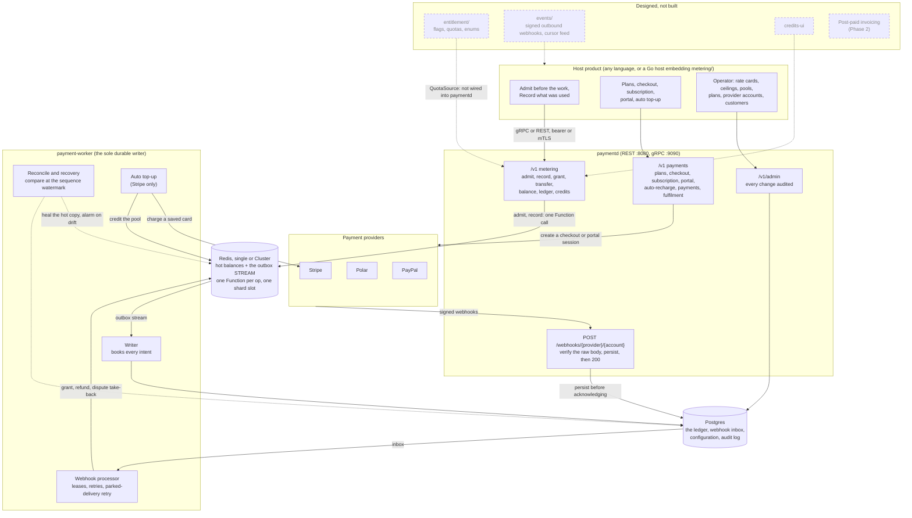

# 💳 intel-payment — Metering, Credits and Payments Engine

### A reusable credit-metering and payments service: refuse-before-spend on Redis, the books on Postgres, money in from Stripe, Polar and PayPal

**A hot-path admission gate, exact pricing, exactly-once accounting and a single durable writer**, behind gRPC and REST,
with a webhook door that persists a payment provider's delivery before it acknowledges it. Drop it in front of any
product that needs to count usage, enforce budgets and take money, as a Go library or as a self-contained container.

The product-specific part is three parameters: a **rate card** (data), a **scope** with its **subjects** (your request
context) and a **realm** (which product this is). Everything else is generic, and the conformance suites run unchanged
across rate cards over three disjoint unit spaces, so that is a test result rather than a claim.

[](https://github.com/truongpx396/intel-payment/actions/workflows/ci.yml)
[](#-testing)
[](#-architecture)
[](#-safety-model)
[](#-payments)
[](#-testing)
[](./LICENSE)

> **Status, stated honestly.** The **metering core** and the **payment pipeline** are built, verified in CI and served by
> two binaries, `paymentd` and `payment-worker`. **Entitlements, outbound events, the operational surface and the credits
> UI are designed, not built** (`entitlement/` and `events/` are stubs), and **post-paid invoicing**
> ([Phase 2](specs/002-postpaid-invoicing/)) is designed, not built. The provider adapters have met their sandboxes
> once ([docs/sandbox.md](docs/sandbox.md)): not a buyer approving a PayPal order, a paid Polar order, or a live account.
> Sub-millisecond admission is the design target; nothing has been load tested. The task count and the gap list are in
> [ROADMAP.md](ROADMAP.md), which CI checks against the task lists.
>
> **Scope:** a *metering, credits and payment-collection engine* for products that need an internal credit unit with
> refuse-before-spend enforcement on the request path. If you do not need that, [ROADMAP.md](ROADMAP.md) names the
> tools you probably want instead.

* * *

## 📑 Table of Contents

- [🎯 Highlights](#-highlights)
- [🧭 Architecture](#-architecture)
- [🌍 Deployment shapes](#-deployment-shapes)
- [🚀 Quickstart](#-quickstart)
- [💬 Things to try](#-things-to-try)
- [🌐 API](#-api)
- [📐 Configuration](#-configuration)
- [💳 Payments](#-payments)
- [🔒 Safety model](#-safety-model)
- [📊 Observability](#-observability)
- [✅ Testing](#-testing)
- [🔍 Security scanning and load testing](#-security-scanning-and-load-testing)
- [🔧 Make targets](#-make-targets)
- [📁 Repo map](#-repo-map)
- [🚧 Roadmap and known gaps](#-roadmap-and-known-gaps)
- [🩺 Troubleshooting](#-troubleshooting)
- [📚 Further reading](#-further-reading)
- [🧬 Provenance](#-provenance)
- [📄 License](#-license)

* * *

## 🎯 Highlights

| Layer | Tool |
|---|---|
| 🧠 Engine | **Go 1.26**: `metering/` (`domain` → `ports` → `app` → `adapters`), standalone and portable; `billing/` on metering's ports only |
| ⚡ Hot path | **Redis 7**, single or Cluster: one Redis Function per operation, every key in the scope's shard slot; the outbox is a Stream in the same slot |
| 📒 Books | **PostgreSQL 16**: the ledger, the webhook inbox, configuration and its audit log; forward-only migrations |
| 🔌 Transports | **gRPC** and **REST** (OpenAPI) behind a service credential, bearer or mTLS; a Go client, and TypeScript and Python clients generated from the OpenAPI document |
| 🚌 Bus | **Redis Streams** by default; **NATS JetStream** optional, for downstream replication |
| 💳 Payments | **Stripe**, **Polar** and **PayPal** behind one provider port; signed webhooks into a Postgres inbox |
| 📈 Observability | **OpenTelemetry** metrics exposed at `/metrics` in the Prometheus format |
| 🧪 Quality | Testcontainers, Playwright, `gremlins` mutation testing, fuzz targets, `go-arch-lint` + `depguard`, `govulncheck`, `gitleaks` |

**Built and verified**

- ⏱️ **No durable-store wait on the hot path.** Pool draws, the sequence number, the idempotency guard, window counters and the outbox `XADD` happen in one Redis Function.
- 🧮 **Exact pricing.** Prices are rationals (`$0.15 per million` is exact), rounding is up **once per event**, and no float touches a balance, a price or a ledger row.
- 1️⃣ **Exactly-once accounting.** A permanent guard for anything that mints money, a window-bounded one for usage, each with a request fingerprint: a reused key with a different request is an error, never a silent no-op.
- 🚫 **Refuse before you spend.** The gate evaluates every ceiling *and* the call's cost bound, so overshoot is bounded rather than hoped for.
- 🎚️ **Ceilings that fit real products.** Per scope or per **subject** (member, API key, project), in calendar or rolling windows, plus a `Job` budget that stops one runaway loop independently of every calendar limit.
- 🏊 **Credit pools.** Promotional credits are spent before paid ones; credits can be restricted to some resources; optional expiry spends the soonest-expiring lot first.
- 🔁 **Transfers.** Credits move between scopes in two phases, refusing to overdraw, with the realm's total conserved at every step.
- ⚖️ **Books that reconcile honestly.** Reconcile compares the fast copy with the books *at the same sequence number*, so in-flight charges are never mistaken for drift, and real drift pages.
- 🧯 **Recovery that is a procedure.** A Redis restart, failover or loss freezes the affected shards, drains them and rebuilds them from the books; usage during an outage is journaled, never dropped.
- 💳 **Payments that cannot lose or double a grant.** Webhooks are verified on the raw body and persisted *before* they are acknowledged, then processed with leases and retries.
- 📝 **Configuration you can trust.** An admin API for rate cards, ceilings, pools, plans, provider prices, provider accounts and customers; the database itself audits every change, even a direct SQL write.
- 📦 **Library or container.** The same ports embedded in-process or behind gRPC and REST; a `Meter` behind gRPC is shown to be the same value as the engine, by a suite that is itself shown to reject five broken transports.
- 🧱 **A boundary you cannot cross by accident.** `go-arch-lint` and `depguard` make the portability guarantee a CI gate, and `check-spec-drift` does the same for the contracts.

**Designed, not built**

- 🎫 **Entitlements**: flags, quotas and enums as data, with `override > subscription > default` precedence and provenance. The schema is in; the service is not.
- 📣 **Outbound events**: signed, retried webhooks and a cursor feed, so hosts never touch internals.
- 🖼️ **A credits UI**: balances per pool, ceilings, spend, ledger and plans.
- 🧾 **Post-paid invoicing**: rating, tiered schedules, commitments, immutable invoices and credit notes ([Phase 2](specs/002-postpaid-invoicing/)).

* * *

## 🧭 Architecture

Every operation that changes a balance is applied to Redis first, in one Function call that also appends an *intent* to
an outbox stream in the same slot. `payment-worker` is the **only** process that writes the books: it drains the outbox
and books each intent in Postgres, and reconcile compares the two at the same sequence number. A payment is the same
machine with a door in front: the provider's webhook is persisted to a Postgres inbox, and only then acknowledged and
processed, and a purchase mints credits by granting them through the engine.



- 🧱 **Ports and adapters.** `metering/` and `billing/` are each `domain` → `ports` → `app` → `adapters/{driven,driving}`. `billing/` depends on metering's *ports* only; `metering/` never imports `billing`, `entitlement`, `events` or `cmd` (`make verify-portability`). `os.Getenv` is called only in `cmd/`, and there is no `time.Now` in the core.
- 🟥 **Redis is a money store.** `noeviction`, AOF, and an ACL that gives every principal other than `paymentd` and `payment-worker` nothing ([deploy/redis/](deploy/redis/README.md)). It holds the hot balances and the outbox; the books can rebuild it.
- 🗄️ **Postgres is the book of record.** Migrations are forward-only. `payment-worker` holds one connection per shard it owns: at the default 256 shards, about 272 connections per worker (the compose Postgres runs with `max_connections=400`).
- 📮 **The worker drains the Redis outbox.** The JetStream intent path exists in the engine and is refused by the binary; JetStream is an option for downstream replication.
- 🚪 **The webhook door is signature-only**: no JWT, no CORS. A delivery is verified on its raw body, persisted, then acknowledged.
- 🔢 **256 shards by default** (`PAYMENT_SHARDS`). It cannot change after the first start without a reshard.

* * *

## 🌍 Deployment shapes

| | 📚 Embedded library | 🐳 Container service |
|---|---|---|
| **Host** | A Go host importing `metering` | Any language, over gRPC (hot path), REST and the generated clients |
| **`Admit` is** | An in-process Redis call | A network call, so **co-locate it**: it is on every request |
| **Run** | `app.New(metering.Config{…}, app.Deps{…})` | `make up`: Postgres, Redis, `payment-migrate`, `paymentd`, `payment-worker` (no broker) |

- 🏷️ **Multi-product**: one deployment, one realm per product. Plans, cards, ceilings, pools, provider accounts, credentials and idempotency keys are all realm-partitioned.
- 🌐 **Region**: one home region, with Postgres replicated to a DR region and Redis rebuilt from the books. Active-active is out of scope by decision ([D45](specs/001-metering-billing-core/design-decisions.md)).
- 📦 **What ships for production**: a distroless, non-root image, the Redis ACL, and `make verify-deploy`, which builds the image, migrates an empty Postgres and proves the ACL by attempting what it forbids. **No production compose file, orchestrator manifests or infrastructure-as-code ship here**, and [the runbook](docs/operations.md) is written from reasoning, not from an incident.
- 🔀 **Rollout order**: `make migrate` → `payment-worker` → `paymentd`. `/readyz` fails while the schema is behind head, so wire it as the rollout gate.

* * *

## 🚀 Quickstart

**Prerequisites:** 🐳 Docker with Compose v2 · free host ports **8080** (REST) and **9090** (gRPC) · `openssl`, `shasum` and `curl` for the steps below. 🐹 Go 1.26+ only to run the tests; 🟢 Node ≥ 22 and 🐍 Python ≥ 3.11 only for `make verify-clients`.

**1. Configure.** A caller authenticates with a bearer token; the configuration holds only its SHA-256 digest, never the
token, and an empty `PAYMENT_SERVICE_TOKENS` accepts no caller. One token per privilege, because a spend producer must
never hold the credential that mints credits:

```bash
export PAYMENT_TOKEN=$(openssl rand -hex 16)         # privilege: record
export PAYMENT_GRANT_TOKEN=$(openssl rand -hex 16)   # privilege: grant  (mints credits)
export PAYMENT_ADMIN_TOKEN=$(openssl rand -hex 16)   # privilege: admin
digest() { printf %s "$1" | shasum -a 256 | cut -d' ' -f1; }

# .env = .env.example with the token line filled in (realm `default`, which is what `make seed` seeds)
{ grep -v '^PAYMENT_SERVICE_TOKENS=' .env.example
  echo "PAYMENT_SERVICE_TOKENS=app:$(digest "$PAYMENT_TOKEN"):default:record,granter:$(digest "$PAYMENT_GRANT_TOKEN"):default:grant,admin:$(digest "$PAYMENT_ADMIN_TOKEN"):default:admin"
} > .env
```

To serve a realm of your own, set `PAYMENT_REALM` in `.env`, name the same realm in each token, and run
`make seed REALM=<it>`.

**2. Start and seed.**

```bash
make up                         # postgres + redis + migrations + paymentd + payment-worker (no broker)
curl -s localhost:8080/readyz   # {"status":"ready","migrations":"head","shards":256}
make seed                       # a promo pool, a rate card, three ceilings, two plans, a free tier, a test Stripe account
```

**3. Size the per-member ceiling.** The seed sizes `user_daily` from the plan's entitlement, and `paymentd` has no
entitlement source yet, so on a seeded realm `/v1/admit` answers `503 quota_unavailable`. Until entitlements exist, give
the ceiling a fixed size (it applies to the next `admit`):

```bash
curl -s localhost:8080/v1/admin/limits/user_daily -X PUT -H "Authorization: Bearer $PAYMENT_ADMIN_TOKEN" \
  -d '{"actor":"quickstart","reason":"fixed size until entitlements exist","subject_kind":"user","unit":"credit",
       "max":10000000,"window":"daily","tz":"UTC","warn_at":0.8,"deny_code":"limit_reached"}'
```

**4. Meter something.**

```bash
# Credit the scope. In production only the webhook processor mints; this is the privileged shortcut.
curl -s localhost:8080/v1/grant -H "Authorization: Bearer $PAYMENT_GRANT_TOKEN" -H 'Idempotency-Key: signup-org_1' \
  -d '{"scope":{"kind":"organization","id":"org_1"},"pool":"promo","amount":5000000,"reason":"signup_grant"}'

# Gate BEFORE the work. max_cost bounds overshoot — pass it. With no credit this is HTTP 402 payment_required.
curl -s localhost:8080/v1/admit -H "Authorization: Bearer $PAYMENT_TOKEN" \
  -d '{"scope":{"kind":"organization","id":"org_1"},"resource":"llm.chat","subjects":{"user":"u_1"},"max_cost":50000}'
# → {"allowed":true,"headroom":2000000,"blocked":false}

# Settle with what was ACTUALLY produced — including on cancellation. occurred_at must be recent:
# an event older than the usage window (71h by default) is refused as stale_event.
NOW=$(date -u +%FT%TZ)
RECORD=$(cat <<EOF
{"scope":{"kind":"organization","id":"org_1"},"resource":"llm.chat","rate_key":"gpt-4o",
 "subjects":{"user":"u_1"},"occurred_at":"$NOW",
 "quantities":[{"unit":"llm_input_token","amount":1200},{"unit":"llm_output_token","amount":800}]}
EOF
)
curl -s localhost:8080/v1/record -H "Authorization: Bearer $PAYMENT_TOKEN" -H 'Idempotency-Key: call-abc' -d "$RECORD"
# → {"idem_key":"call-abc","applied":true,"deferred":false,"delta":-11000,"balance":4989000,"seq":2,"rate_card_version":"2026-01-01","writeoff":0}   (1 credit = 1 µ$)

# Replay it. Nothing happens — that is the whole point.
curl -s localhost:8080/v1/record -H "Authorization: Bearer $PAYMENT_TOKEN" -H 'Idempotency-Key: call-abc' -d "$RECORD"
# → {"idem_key":"call-abc","applied":false,"deferred":false,"delta":0,…,"seq":2,…}
# The same key with a different request is refused, never silently swallowed: HTTP 409 idempotency_conflict.
```

**5. Take a payment.** Register a provider account and map a plan to the provider's price through `/v1/admin`, point the
provider's webhook at `/webhooks/{provider}/{account}`, and start a checkout with `POST /v1/checkout`. Credits appear
when the verified webhook is *processed*, not on the redirect. [docs/sandbox.md](docs/sandbox.md) runs this against each
provider, and the [quickstart](specs/001-metering-billing-core/quickstart.md) has the long walkthrough.

**Without the stack**, the design verifies itself:

```bash
make test                # unit tests and every conformance suite
make verify-hot-path     # the reference Redis Functions on Redis 7 in cluster mode (Docker)
make verify-schema       # migrations, seed and behavioural assertions on an empty Postgres (Docker)
```

### 🚨 Four things that bite on a first run

- 🔑 **An empty `PAYMENT_SERVICE_TOKENS` accepts no caller.** Every call is a `401 unauthenticated` until step 1 is done.
- 🎫 **A seeded realm answers `/v1/admit` with `503 quota_unavailable`** until step 3. `paymentd` has no entitlement source, and the seed sizes `user_daily` from one.
- 🕰️ **`occurred_at` must be recent.** An event older than the usage window is refused as `422 stale_event`, so a copy-pasted fixed date stops working within three days.
- ✍️ **Admin writes need `actor` and `reason`** in the body; without them the call is `400 invalid_request`.

<details>
<summary>🔌 Ports the stack publishes</summary>

| Service | Host port | Move it with |
|---|---|---|
| `paymentd` REST | 8080 | fixed in `deploy/docker-compose.yml` |
| `paymentd` gRPC | 9090 | fixed in `deploy/docker-compose.yml` |
| Postgres | 5432 | `PAYMENT_POSTGRES_PORT` |
| Redis | 6379 | `PAYMENT_REDIS_PORT` |
| NATS (`make up-jetstream` only) | 4222 | fixed |

</details>

* * *

## 💬 Things to try

Every call below was run against a freshly seeded stack. Set up the tokens and the fixed ceiling from the
[Quickstart](#-quickstart) first.

**⚙️ The metering API**

| Try | What it shows |
|---|---|
| `admit` for a scope with no credit | 🚫 HTTP 402 `payment_required`, `allowed:false`, `exceeded.name` = `scope_balance`: refused before any work |
| `grant` twice with one `Idempotency-Key` | 🔁 The second answers `applied:false`, `delta:0` |
| `record` twice with one key, then with different quantities | 1️⃣ The replay applies nothing; the changed request is `409 idempotency_conflict` |
| `record` with an `occurred_at` days old | 🕰️ `422 stale_event`: usage older than the dedup window is refused |
| `transfer` more than the source holds | ⚖️ `409 insufficient_balance`: refused rather than overdrawn |
| `transfer`, then `GET /v1/transfers/{key}` | 🔁 `in_transit`, then `settled`: both sides, never one |
| `GET /v1/ledger` for the scope | 📒 The rows the worker booked, newest first, with a rising `seq` and the rate-card version on the usage row |
| `GET /v1/credits` | 🖼️ Everything a credits screen shows, in one round trip |
| `GET /v1/plans?currency=USD` | 🛒 What the realm sells: slugs, prices, credit allotments, never a provider's price id |

```bash
# Move credits between two scopes (privilege: grant), then follow it
curl -s localhost:8080/v1/transfer -H "Authorization: Bearer $PAYMENT_GRANT_TOKEN" -H 'Idempotency-Key: move-1' \
  -d '{"from":{"kind":"organization","id":"org_1"},"to":{"kind":"organization","id":"org_2"},
       "from_pool":"promo","to_pool":"promo","amount":1000000,"reason":"allocation"}'
# → {"idem_key":"move-1","applied":true,"amount":1000000,"from_balance":3989000,"status":"in_transit"}
curl -s localhost:8080/v1/transfers/move-1 -H "Authorization: Bearer $PAYMENT_GRANT_TOKEN"   # → "status":"settled"

curl -s "localhost:8080/v1/balance?scope_kind=organization&scope_id=org_1" -H "Authorization: Bearer $PAYMENT_TOKEN"
# → {"pools":{"promo":3989000},"total":3989000}
curl -s "localhost:8080/v1/ledger?scope_kind=organization&scope_id=org_1&limit=10" -H "Authorization: Bearer $PAYMENT_TOKEN"
# → {"data":[{…"operation_type":"allocation_out","delta":-1000000,"seq":3},{…"llm.chat","delta":-11000,"seq":2},{…"signup_grant","delta":5000000,"seq":1}],"next":null}
```

**🔐 The credential model**

| Try | What it shows |
|---|---|
| Any call with no `Authorization` header | 🔑 `401 unauthenticated` |
| The `record` token on `POST /v1/grant`, or on `/v1/admin/*` | 🚦 `403 forbidden`: the credential holds `record`, the call needs `grant` or `admin` |
| `GET /readyz` | 🩺 `{"status":"ready","migrations":"head","shards":256}`; it fails while the schema is behind head |
| `GET /metrics` | 📈 Prometheus text: `metering_admit_latency_seconds`, `metering_admit_denied_total`, … |

**🔬 Beyond the API**

| Try | What it shows |
|---|---|
| `make verify-hot-path` | ⚡ The reference Redis Functions behave on a real Redis 7 in cluster mode |
| `make verify-equivalence` | 🧪 A `Meter` behind gRPC is the same value as the engine, and the suite rejects five broken transports by name |
| `make fuzz FUZZTIME=20s` | 🎲 Arithmetic, encodings and time logic searched beyond their seeds |
| `make mutation-diff REF=origin/main` | 🧬 Whether the tests fail when the lines you changed are wrong |
| `make verify-boundary` | 🧱 One planted violation per boundary rule, and each is rejected |

* * *

## 🌐 API

Every route is under `/v1` and carries a **privilege**: `record` for a spend producer, `grant` for anything that mints or
moves credits or changes a subscription, `admin` for configuration. The normative surface is
[rest-api.md](specs/001-metering-billing-core/contracts/rest-api.md) and
[grpc-surface.md](specs/001-metering-billing-core/contracts/grpc-surface.md); the OpenAPI document is
`api/openapi/v1.yaml`.

| Endpoint | Privilege | Purpose |
|---|---|---|
| `POST /v1/admit` | record | Decide whether an operation may start |
| `POST /v1/record` | record | Record what an operation used, exactly once |
| `POST /v1/grant` | grant | Mint credits into a pool, or claw them back |
| `POST /v1/transfer` · `GET /v1/transfers/{key}` | grant | Move credits between two scopes of one realm · where a transfer is |
| `GET /v1/balance` · `/v1/ledger` · `/v1/credits` | record | A scope's balance · its booked rows, newest first · everything a credits screen shows |
| `GET /v1/plans` | record | What the realm sells, in one currency |
| `POST /v1/checkout` · `GET /v1/portal` | record | Start a hosted checkout · the provider's page for cards and invoices |
| `GET /v1/subscription` | record | The scope's subscription, or `null` |
| `POST /v1/subscription/change` · `/cancel` | grant | Ask the provider to move or end the subscription (accepted, never reported as made) |
| `GET /v1/auto-recharge` · `PUT /v1/auto-recharge` | record · grant | The standing instruction to top up · set it |
| `GET /v1/payments` · `GET /v1/fulfilment` | record | Payment history · what the server says about the credits the latest purchase should bring |
| `/v1/admin/rate-cards` | admin | Publish a rate card version; list them |
| `/v1/admin/limits/{name}` · `/v1/admin/pools/{name}` | admin | Create, replace, read or remove a ceiling · a pool |
| `/v1/admin/plans` · `/{code}` · `/{code}/provider-prices/{account}/{currency}` | admin | Plans, taking them on or off sale, and mapping a price to the provider's |
| `/v1/admin/provider-accounts` · `/v1/admin/customers` | admin | Provider accounts (secrets are references) · linking a scope to a provider customer |
| `POST /webhooks/{provider}/{account}` | signature | The provider's delivery. No credential, no CORS: the signature is the credential |
| `GET /healthz` · `/readyz` · `/metrics` | none | Up · may be sent traffic · Prometheus exposition |

Admin writes take `actor` and `reason` in the body; every change is audited.

| `PAYMENT_SERVICE_AUTH` | A caller is | Use it for |
|---|---|---|
| `bearer` (what `.env.example` selects) | `<caller-id>:<sha256 of the token>:<realms>:<privileges>`, comma-separated, in `PAYMENT_SERVICE_TOKENS` | Most deployments. The configuration holds the digest, never the token; a plaintext token is refused at start-up |
| `mtls` | `<caller-id>:<certificate common name>:<realms>:<privileges>` in `PAYMENT_SERVICE_CERTS` | Callers that hold certificates from a private CA (`PAYMENT_TLS_*`) |
| `none` | Anyone | Loopback or a Unix socket only; the service refuses to start otherwise |

Realms are joined with `+`, privileges with `+`. No browser should hold a `/v1` credential; the host proxies. See
[docs/security.md](docs/security.md).

* * *

## 📐 Configuration

**Infrastructure and policy** are environment variables; **anything commercially volatile** is Postgres rows behind an
admin API, so launching a price, a ceiling, a pool or a plan needs no deploy; **secrets** are named, never stored.

| Kind | Lives in | Example |
|---|---|---|
| Infrastructure and policy | `PAYMENT_*` environment variables (`.env.example` is the reference) | Redis and Postgres URLs, `PAYMENT_SHARDS`, the policies below |
| Commercial configuration | Postgres rows behind `/v1/admin`, audited | Rate cards, ceilings, pools, plans, provider prices, customers |
| Secrets | The environment or a secret manager, referenced by name | A provider account holds `env:STRIPE_SECRET_KEY`, not the key |

| Policy | Options | Default | Decides |
|---|---|---|---|
| `Settlement` | `outbox` · `journal` | `outbox` | Sub-ms enforcement with a stated under-bill window, or Postgres first and none |
| `HotAckWait` | `none` · `aof_local` · `aof_replica` | `none` | How much of that window to close by waiting for Redis durability |
| `LedgerGranularity` | `event` · `rollup` | `event` | One ledger row per event, or per batch with per-event detail archived: the path past one Postgres's write budget |
| `AdmitFailPolicy` | `fail_closed` · `fail_open` | `fail_closed` | Hot store down: refuse, or serve and meter on recovery |
| `NegativeBalancePolicy` | `allow_debt` · `clamp_to_zero` · `block_and_flag` | `clamp_to_zero` | What a refund past consumed credits does |
| `CreditExpiry` | `off` · `lots_fefo` | `off` | Whether grants expire; the lot that lapses soonest is spent first |
| `PlanChangePolicy` | `at_period_end` · `immediate_prorate` · `immediate_no_prorate` | `at_period_end` | Mid-period upgrades |
| `TaxStrategy` | `provider_managed` · `none` (`external_hook` when embedded as a library) | `provider_managed` | **Who** computes tax. The binary refuses `external_hook`: it cannot be given your tax service |
| Dunning | grace days · suspend-after | `7` · `14` | How long a failed payment keeps access. Grace is enforced by `payment-worker`; suspend-after is read by nothing until entitlements exist |

Full reference: [docs/configuration.md](docs/configuration.md). The design's sizing:
[scale envelope](specs/001-metering-billing-core/plan.md#scale-envelope).

* * *

## 💳 Payments

A purchase is only ever believed when the provider's webhook says so. The flow, end to end:

1. The host calls `POST /v1/checkout` naming a **plan** (never a price) and gets a redirect URL. Credits do **not** appear on the redirect.
2. The provider delivers a signed webhook to `POST /webhooks/{provider}/{account}`. `paymentd` verifies it on the raw body, persists it to the inbox, and only then answers `200`. A crash after the `200` can delay a grant, never lose it.
3. `payment-worker` takes the delivery from the inbox with a lease, and processes it with retries.
4. A purchase grants credits through `Meter.Grant`, exactly once. The host polls `GET /v1/fulfilment` and watches `processing` → `granted`.

- ↩️ **Refunds are cumulative** and take back exactly the credits owed. A **chargeback** and a **won dispute** are exact inverses. Out-of-order deliveries are handled exactly.
- ⏳ **A failed payment opens a grace window** (`PAYMENT_DUNNING_GRACE_DAYS`, 7 by default).
- 🔋 **Auto top-up** charges the saved card when a pool falls under its threshold, at most `max_per_day` times a day. It works on **Stripe only**: Polar and PayPal cannot charge a saved method.
- 🅿️ **PayPal** verifies each delivery with an API call to PayPal, and parks the delivery for retry when PayPal cannot answer.
- 🧾 **Tax** is `provider_managed` by default.

| Provider | Rehearsed against | Not yet rehearsed |
|---|---|---|
| **Stripe** | A test-mode account (API 2024-06-20): one-time packs, subscriptions (create, change, cancel), hosted checkout in `payment`, `subscription` and `setup` modes, the billing portal, a failed payment, partial refunds, a dispute lost then won, an auto top-up charging a saved card | Test clocks (dunning and grace over real time), a live-mode account's own settings |
| **Polar** | The sandbox: webhook signature, a free order's `order.created` and `order.paid`, product and checkout creation, the grant | A paid order, refund and renewal |
| **PayPal** | The sandbox and its webhook simulator: OAuth, order creation and its approval link, PayPal's own verify call, the dispute events | A buyer approving an order (the v2 capture, refund and reversal shapes), subscriptions |

The rehearsal found and fixed two defects (an auto top-up that charged the card and granted nothing; a first checkout on a
new Stripe account that failed), and the deliveries it captured are checked in: every adapter is tested against them. The
full record, and how to repeat it for your own account, is [docs/sandbox.md](docs/sandbox.md).

* * *

## 🔒 Safety model

From the [constitution](.specify/memory/constitution.md): thirteen principles, whose non-negotiable ones are **Money
Integrity**, **Exactly-Once by Construction** and **Verification Before Completion**.

- 🔢 **Integer money only.** Amounts are signed `int64`; fiat is integer minor units plus an ISO-4217 currency. Credits and money are distinct types. Arithmetic that could wrap is refused, not wrapped.
- ✍️ **One durable writer.** Request tiers publish intents; the worker books every one, not even a transfer excepted.
- 🚫 **Fail closed, fail loud.** An unknown rate key or unit, or an unreachable store, **denies**: nothing is priced at zero and nothing is granted by default. Drift beyond tolerance alarms; it is never healed silently.
- 🚦 **Refuse before you spend.** The gate runs before the expensive work.
- 🔏 **Webhooks are verified first**: on the raw body, in constant time, inside a timestamp tolerance, before any parse or side effect.
- 🔐 **Least privilege.** A credential is bound to realms and to `record`, `grant` and/or `admin`, so a spend producer cannot mint credits.

| Failure | Defence |
|---|---|
| 🔁 A caller retries a charge | An idempotency key with a request fingerprint: a hot guard for speed, durable unique constraints for correctness. A reused key with a different request is a `409`, never a silent replay |
| 💥 Redis loses acknowledged intents | The **under-bill window is stated exactly**: the last acknowledged intents *and* their balance change are lost together, so the result is under-billing, never double-billing. `HotAckWait` narrows it; `Settlement=journal` removes it |
| 🧮 The fast copy drifts from the books | Reconcile compares only at the same sequence number, heals the fast copy, never books a row, and pages on real drift |
| 🔌 Redis restarts, fails over or is lost | The affected shards freeze, drain and rebuild from the books; usage during the outage is journaled, never dropped |
| 📮 A webhook is replayed, reordered or forged | Verified before anything else, persisted before the `200`, processed with leases; a grant is guarded by a permanent idempotency key |
| 💸 A refund lands after the credits were spent | `NegativeBalancePolicy` decides, and flooring a balance always writes a compensating row |
| 🛠️ A configuration change by direct SQL | Database triggers audit it and signal every cache |

<details>
<summary>📜 The ten load-bearing invariants</summary>

Each one exists because its absence produces a specific money bug. The full list is in
[metering-ports.md](specs/001-metering-billing-core/contracts/metering-ports.md#invariants-every-implementation-must-uphold).

1. **One durable writer.** The worker books every intent; request tiers never write the books, not even for a transfer.
2. **Dual idempotency, fingerprinted.** A hot guard for speed; durable guards for correctness; a reused key with a different request is an error.
3. **Admission gates, never reserves.** Bounded overshoot, and the bound is only real when callers supply a cost bound.
4. **Partial settlement on cancel.** Billed for what was produced.
5. **Exact, replayable pricing, with the card version on the row.** Rational prices, rounded up once per event.
6. **Integer money only.** No float touches a balance, a price or a ledger row.
7. **The under-bill window is stated exactly.** A Redis crash can lose the last acknowledged intents *and* their balance change together, invisibly: under-billing, never double-billing. `HotAckWait` narrows it; `journal` removes it.
8. **Hot equals booked plus suspense, at every sequence number.** Reconcile compares only there, heals the fast copy, and never books a row.
9. **Verify webhooks first; persist before acknowledging.** A crash after `200` can delay a grant, never lose it.
10. **A negative balance is a policy, not an accident.** And flooring one always writes a compensating row.

</details>

* * *

## 📊 Observability

- 📈 **Metrics:** OpenTelemetry instruments exposed at `/metrics` in the Prometheus format. Every terminal state emits a **named** metric, and the names are part of the contract (`metering/ports/metrics.go`, `billing/ports/metrics.go`).
- 🩺 **Health:** `/healthz` says the process is up; `/readyz` says it may be sent traffic and fails while the schema is behind head.
- 🪪 **Audit:** the database writes every configuration change to `audit_log`, even a direct SQL change.
- 📓 **Runbook:** [docs/operations.md](docs/operations.md) has one entry per alert, each naming the metric that fires it.

| Watch | Metric | Healthy |
|---|---|---|
| Admission latency | `metering_admit_latency_seconds` p99 | ≤ 5 ms co-located, ≤ 1 ms embedded (targets, not measurements) |
| **Drift findings** | `metering_drift_findings_total` | **Zero.** Steady traffic produces none, by construction |
| Outbox depth and age | `metering_outbox_depth`, `metering_outbox_age_seconds` | Depth low, age in seconds |
| Frozen shards · regressions | `metering_shard_frozen_seconds`, `metering_hot_regression_total` | Zero outside a recovery; each regression is a Redis restart or failover |
| Fail-open | `metering_admit_failopen_total` | **Zero** on a `fail_closed` deployment |
| **Webhook verification failures** | `billing_webhook_verify_failed_total` | Zero. A security signal |
| Webhook inbox age | `billing_webhook_inbox_age_seconds` | Seconds |

⚠️ **No alert rules or dashboards ship in this repository**, and the runbook has not been exercised in an incident.
The table is what to build; [docs/operations.md](docs/operations.md) says what to page on.

* * *

## ✅ Testing

Test-first is the rule, and the evidence is checked: a production change arrives as a failing tests-only
`test(red)` commit, then its fix, and CI verifies that order. [docs/testing.md](docs/testing.md) has the loop, the commit
shape, properties and fuzzing, and when mutation testing applies.

| Tier | Command | Needs | In CI | Proves |
|---|---|---|---|---|
| 🧪 Unit and conformance | `make test` | nothing | `go` | The domain, `app`, the pricers, and every conformance suite (`PricerContract`, `LedgerContract`, `LedgerWriterContract`, `ConsistencyContract`, `BusContract`), with `-race -shuffle=on` |
| 🐳 Integration | `make test-integration` | Docker | `go` | A real Redis and Postgres (Testcontainers): the writer, recovery, migrations, the transports and the payment routes |
| 🔁 Equivalence | `make verify-equivalence` | Docker | `go` | A `Meter` behind gRPC is the same value as the engine, and the suite rejects five broken transports |
| 🎲 Fuzz | `make fuzz` | nothing | `fuzz` (short) and nightly (deep) | Arithmetic, encodings and time logic |
| 🧬 Mutation | `make mutation-diff REF=origin/main` | `gremlins` | `mutation` and nightly (whole targets) | The tests fail when the changed lines are wrong |
| 🔴 Red-green | `make verify-red-green` | a branch | `red-green` | A failing tests-only commit precedes every production change |
| 🧱 Boundary | `make lint` · `make verify-portability` · `make verify-boundary` | `golangci-lint`, `go-arch-lint` | `go` | The architecture graph holds, `metering/` stands alone, and the gates reject planted violations |
| 🗄️ Schema | `make verify-schema` | Docker | `migrations` | Every migration, the seed and behavioural assertions on an empty Postgres, plus the Phase 2 draft |
| ⚡ Hot path | `make verify-hot-path` | Docker | `hot-path` | The reference Redis Functions on Redis in cluster mode |
| 🚢 Deploy | `make verify-deploy` | Docker | `deploy` | The image builds, an empty Postgres migrates, and the Redis ACL refuses what it should |
| 🌐 End to end | `make e2e` | `make up`, Node | `e2e` | Playwright against the built image: health and credential checks |
| 🧰 Clients | `make verify-clients` | Node ≥ 22, Python ≥ 3.11, network | `clients` | The TypeScript and Python clients generated from OpenAPI compile and round-trip an `Admit` |
| 📜 Documents | `scripts/check-spec-drift.sh` | nothing | `drift`, `docs` | No document describes a retired mechanism as current, ROADMAP's task counts match `tasks.md`, and no relative link dangles |

`make ci` runs the local equivalents of all of it **except** `verify-schema`, `verify-clients`, the e2e suite and the two
gates that need a branch history (`verify-red-green`, `mutation-diff`): run those before opening a pull request.
`internal/chaos` is a fault-injecting proxy the integration tests use; `internal/pgtest` is their Postgres fixture.

**Contributing.** Go 1.26+. Work happens on a branch and arrives as a pull request. The rules a change to the money path
answers to are the [constitution](.specify/memory/constitution.md); [CLAUDE.md](CLAUDE.md) is the working guide, and the
[pull-request template](.github/pull_request_template.md) says what a PR must show.

* * *

## 🔍 Security scanning and load testing

| Tool | Checks | Run | CI |
|---|---|---|---|
| [govulncheck](https://pkg.go.dev/golang.org/x/vuln/cmd/govulncheck) | Known vulnerabilities in the dependencies and the standard library | `make vuln` | Every change, and nightly with a fresh database |
| [gitleaks](https://github.com/gitleaks/gitleaks) | Secrets in the tree and the history | `make secrets` | Gate |
| `depguard` · `go-arch-lint` | No provider SDK outside its adapter, no `os.Getenv` outside `cmd/`, no float for money, metering imports nothing above it | `make lint` | Gate |
| `buf` | The protobuf definitions lint, the generated Go is current, and nothing released breaks | `make proto-check` | Gate |

- ⚠️ **Not done:** the checklists in [docs/security.md](docs/security.md) exist, and **none has been executed**. A load test of the hot path has not been run (the [scale envelope](specs/001-metering-billing-core/plan.md#scale-envelope) states targets, and none is a measurement until it is).
- 🔑 A real `.env` is never committed; `.env.example` holds names, never values.

* * *

## 🔧 Make targets

`make help` lists everything. The ones you will use:

| Target | Does |
|---|---|
| **▶️ Run** | |
| `make up` · `make down` | Start the stack (Postgres, Redis, migrations, `paymentd`, `payment-worker`) · stop it, keeping data |
| `make up-jetstream` | The same with NATS JetStream as the bus instead of Redis Streams |
| `make migrate` · `make seed REALM=…` | Run migrations to head · seed a realm: pools, a rate card, ceilings, plans, a free tier |
| `make logs` · `make build` | Tail `paymentd` and `payment-worker` · build every binary |
| **✅ Test** | |
| `make test` · `make test-integration` | Unit and conformance (parallel, shuffled, race detector) · real Redis and Postgres (Docker) |
| `make fuzz` · `make mutation` · `make mutation-diff` | Search the fuzz targets · mutation-test every target · mutation-test only the lines changed since `REF` |
| `make verify-red-green` · `make verify-tdd-gates` | The branch was test-driven · the TDD gates refuse what they should |
| **🔎 Verify** | |
| `make verify-schema` · `make verify-hot-path` · `make verify-deploy` | Migrations and seed · the Redis Functions on a cluster · the image and the Redis ACL |
| `make verify-clients` · `make verify-equivalence` | The generated clients · the transport-equivalence suite |
| `make verify-portability` · `make verify-boundary` | `metering/` stands alone · the boundary gates reject violations |
| **🧹 Quality** | |
| `make fmt` · `make lint` · `make arch-lint` | Format · `golangci-lint` and the architecture graph · the architecture graph alone |
| `make vuln` · `make secrets` | `govulncheck` · `gitleaks` |
| **🔌 API** | |
| `make proto-tools` · `make proto` · `make proto-check` | Install the pinned generators · regenerate `api/meteringv1` · the generated code is current and breaks nothing |
| **🌐 End to end** | |
| `make e2e-install` · `make e2e` | Install the e2e dependencies · run Playwright against `E2E_BASE_URL` (the local stack by default) |
| **🏁 Everything** | |
| `make ci` | What CI runs on every change (see [Testing](#-testing) for what it leaves out) |

⚠️ `make down-volumes` **deletes all data, the ledger included.** There is deliberately no down-migration target:
migrations are forward-only, and in development `make down-volumes && make up` rebuilds the schema from scratch.

* * *

## 📁 Repo map

```
metering/              the engine, standalone and portable; imports nothing above it
  domain/              money, credits, limits, events, intents, request fingerprints — imports nothing
  ports/               what the engine needs (books, bus, clock, metrics, …) and what it offers (Meter)
  app/                 admit, record, grant, transfer, the writer, reconcile, recover, expiry, journal
  adapters/driven/     redis (hot_path.lua), postgres, redisstreams, natsjetstream, otel, pricing, archive, system
  adapters/driving/    grpcserver, grpcclient, resthandler, wire, auth
  contracts/           the conformance suites every adapter must pass
billing/               the payment layer; depends on metering's ports only
  domain/ ports/ app/  checkout, webhook ingress, the processor, plan change, auto top-up, admin
  adapters/driven/     postgres, stripe, polar, paypal
  adapters/driving/    webhookhttp (the door), paymenthttp (/v1 payments and /v1/admin)
  contracts/           the provider conformance suites and the captured sandbox deliveries
entitlement/ events/   designed; doc.go stubs
cmd/                   paymentd, payment-worker, payment-migrate; internal/{envcfg,payments,wiring}
api/                   proto/ (buf), meteringv1/ (generated Go), openapi/v1.yaml
migrations/ migrate/   0001–0005, forward-only, and the migrator that applies them
specs/                 001-metering-billing-core (spec, plan, tasks, decisions, contracts/) and 002-postpaid-invoicing (draft)
integration/           Testcontainers stack tests: writer, recovery, transports, payment routes
internal/              pgtest (Postgres fixture), chaos (fault-injecting proxy)
e2e/                   Playwright against the built image
scripts/               every verification gate, seed.sql, the drift and task-pair checks
deploy/                docker-compose.yml, the Dockerfile, the Redis ACL
docs/                  configuration, integration-guide, operations, security, sandbox, testing
design-system/         the credits screen design (the UI itself is not built)
.specify/memory/       the constitution
.github/workflows/     ci.yml
```

* * *

## 🚧 Roadmap and known gaps

**❌ Not built** (the phases and reasoning are in [ROADMAP.md](ROADMAP.md)):

- **Entitlements.** `entitlement/` is a stub; the schema (migration `0003`) is in, and there is no admin API for them.
- **Outbound events.** Signed webhooks and a cursor feed (`events/` is a stub).
- **The operational surface and the credits UI.**
- **Post-paid invoicing** ([Phase 2](specs/002-postpaid-invoicing/)), including coupons, discounts, trials, quantity subscriptions and invoice generation. Phase 1 collects payments; it issues no invoices.
- **A saved payment method captured automatically** from a `setup` checkout. The host passes `payment_method_ref` to `PUT /v1/auto-recharge` itself.
- **The JetStream intent path in the binary.** It exists in the engine; `payment-worker` drains the Redis outbox only.
- **Client libraries on a registry.** The Go client and the generated TypeScript and Python clients are checked to compile and round-trip an `Admit`, and are not published.
- **Revenue recognition and a general-ledger export** ([Phase 3](ROADMAP.md#phase-3--finance-grade)): not designed, and the recommendation is to export to an accounting system instead.
- **Active-active multi-region**: out of scope by decision.

**⚠️ Known gaps:**

- **No entitlement source is wired into `paymentd`.** A ceiling sized by a plan (`max_entitlement`) cannot be resolved, so a freshly seeded realm answers `/v1/admit` with `503 quota_unavailable` until the ceiling is given a fixed size ([Quickstart](#-quickstart), step 3).
- **The provider adapters have met their sandboxes once.** Still owed before a real order: PayPal with a buyer approving an order; a paid Polar order, refund and renewal; PayPal subscriptions; Stripe test clocks; and a live-mode account's own settings. PayPal's `PAYMENT.SALE.REFUNDED` is ignored.
- **Auto top-up works on Stripe only**; Polar and PayPal cannot charge a saved method.
- **A provider's `4xx` reaches a host as `500 internal`** rather than `502 provider_error`, and a webhook about a customer not yet linked (`PUT /v1/admin/customers`) is ignored.
- **Not load tested, not security reviewed, runbook not exercised.** The scale envelope states targets, the security checklists have not been executed, and [docs/operations.md](docs/operations.md) is written from reasoning.
- **A GDPR erasure story** is designed nowhere yet. The billing tables hold `billing_email` and `actor_id`, and ledger rows must survive an erasure request for audit, so the answer is pseudonymization rather than deletion.
- **Dunning's `suspend-after` is read by nothing** until entitlements exist.
- **One Postgres connection per shard** per `payment-worker`, so a worker at 256 shards needs about 272.

* * *

## 🩺 Troubleshooting

| Symptom | Fix |
|---|---|
| Every call is `401 unauthenticated` | `PAYMENT_SERVICE_TOKENS` is empty (it accepts no caller), or the digest in it is not the SHA-256 of the token you send. Redo [Quickstart](#-quickstart) step 1 |
| `403 forbidden`: the credential holds `record`, the call needs `grant` (or `admin`) | Use the token that carries that privilege; there is one per privilege on purpose |
| `503 quota_unavailable` from `/v1/admit` | A seeded ceiling is sized by an entitlement and none is wired. Quickstart step 3 gives it a fixed size |
| `402 payment_required` from `/v1/admit` | The scope has no credit. Grant some, or complete a purchase |
| `422 stale_event` from `/v1/record` | `occurred_at` is older than the usage window (71h by default). Use the time the work happened, which must be recent |
| `400 invalid_request: actor is required` on an admin write | Admin writes take `actor` and `reason` in the body |
| `409 idempotency_conflict` | Expected: the same `Idempotency-Key` was sent with a different request. A new request needs a new key |
| `paymentd` exits at start-up: `PAYMENT_CHECKOUT_RETURN_HOSTS must be a comma-separated list…` | Your `.env` was copied from an older `.env.example`: Compose reads `KEY=   # comment` as the value `# comment`. Put the comment on its own line (the current `.env.example` does) |
| `make up` cannot start `paymentd` | Something else holds host port 8080 or 9090; `paymentd`'s ports are fixed in `deploy/docker-compose.yml`. Move Postgres and Redis with `PAYMENT_POSTGRES_PORT` and `PAYMENT_REDIS_PORT` |
| `/readyz` is not ready | The schema is behind head, or the configured shard count disagrees with `hot_config`. Run `make migrate` |
| Changed `PAYMENT_SHARDS` after the first start | It cannot be changed without a reshard ([operations](docs/operations.md#resharding)) |
| Integration tests fail with `unexpected container status created` | A Testcontainers start-up race when many package binaries start at once; rerun before debugging |

* * *

## 📚 Further reading

| Document | What is in it |
|---|---|
| [**ROADMAP.md**](ROADMAP.md) | What exists, what is designed, what is absent, and when to use something else |
| [**Quickstart (long form)**](specs/001-metering-billing-core/quickstart.md) | Seed a realm, meter something, take a payment, verify the guarantees |
| [**Integration guide**](docs/integration-guide.md) | Adopting it in a host, end to end, plus the anti-patterns |
| [**Contracts**](specs/001-metering-billing-core/contracts/) | The normative surface: ports, invariants, conformance suites |
| [Hot-path consistency](specs/001-metering-billing-core/contracts/hot-path-consistency.md) | How Redis and Postgres stay consistent: key layout, watermark, suspense, recovery |
| [Payment providers](specs/001-metering-billing-core/contracts/payment-provider-ports.md) · [Outbound events](specs/001-metering-billing-core/contracts/outbound-events.md) | The provider port every adapter meets · how hosts will hear what happened |
| [Sandbox rehearsal](docs/sandbox.md) | What the provider adapters have met, what they found, and what is still owed |
| [Spec](specs/001-metering-billing-core/spec.md) · [Data model](specs/001-metering-billing-core/data-model.md) | Requirements and success criteria · the schema and why each constraint exists |
| [Design decisions](specs/001-metering-billing-core/design-decisions.md) | Every decision, with what was rejected, including the two design reviews |
| [Plan](specs/001-metering-billing-core/plan.md) · [Tasks](specs/001-metering-billing-core/tasks.md) | The scale envelope, the build order, the task list |
| [Post-paid invoicing (Phase 2)](specs/002-postpaid-invoicing/) | Rating, tiered schedules, commitments, immutable invoices, credit notes |
| [Configuration](docs/configuration.md) · [Security](docs/security.md) · [Operations](docs/operations.md) · [Testing](docs/testing.md) | Every knob · the threat model · the runbook · how the TDD gates work |
| [Migrations](migrations/README.md) · [Redis ACL](deploy/redis/README.md) · [End-to-end tests](e2e/README.md) | Why they are forward-only · the money store's access rules · running Playwright |
| [Constitution](.specify/memory/constitution.md) | The thirteen principles every change to the money path answers to |

* * *

## 🧬 Provenance

Extracted from [aisat-intel](https://github.com/truongpx396/aisat-intel), where this engine was designed as that
product's credit backbone and deliberately factored for reuse. [PROVENANCE.md](PROVENANCE.md) records what moved, what
was generalized, and what was fixed on the way.

## 📄 License

MIT — see [LICENSE](LICENSE).
